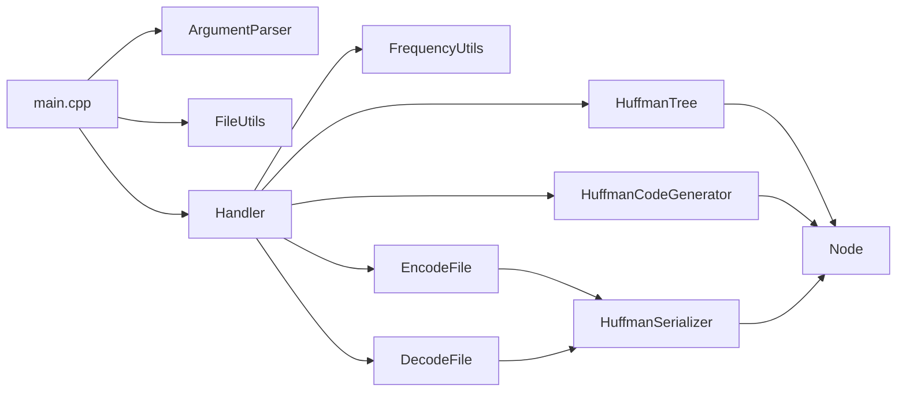

# Architecture

c++ompact is a single-process CMake project: a static library (`cppompact_lib`) plus a thin CLI executable (`cppompact`). There is no server, database, or plugin system.

## Component map



| Module | Role |
|--------|------|
| `src/main.cpp` | Parse args, ensure a default `output` directory exists, dispatch encode/decode |
| `ArgumentParser` | `--encode`/`-e`, `--decode`/`-d`, `--help`/`-h` |
| `Handler` | Orchestrate readability/writability checks, tree build, encode/decode, print sizes |
| `FrequencyUtils` | Count byte frequencies from the input file |
| `HuffmanTree` / `Node` | Build the Huffman tree from frequencies |
| `HuffmanCodeGenerator` | Assign `'0'`/`'1'` string codes by tree walk |
| `HuffmanSerializer` | Preorder serialize/deserialize the tree into the bitstream |
| `EncodeFile` / `DecodeFile` | Pack/unpack payload bits and write/read the on-disk format |
| `FileUtils` | Readable/writable checks, size, mkdir helpers |
| `FileComparisonUtils` | Byte compare (used by tests) |

## On-disk encode format

Assumption (not a published public API — inferred from the implementation):

```
[ tree serialization ][ 1-byte padding ][ MSB-first packed payload... ]
```

- Tree: ASCII flags — `'1'` + leaf byte, or `'0'` + left + right subtrees
- Padding: number of unused bits in the last payload byte
- Payload: Huffman codes packed MSB-first

There is no magic number or version field today. Treat the format as internal until the roadmap adds framing.

## Control flow

**Encode:** parse → check paths → frequency scan → build tree → generate codes → serialize tree → write padding placeholder → pack bits → back-patch padding → print sizes/ratio.

**Decode:** parse → check paths → deserialize tree → read padding → expand/walk bits → write recovered bytes.

## How a change typically lands

1. Prefer editing library code under `src/` + `include/` rather than `main.cpp` unless the change is CLI-only.
2. Keep encode and decode format changes paired so round-trips stay valid.
3. Add or update a Google Test case under `tests/` for behaviour that can break silently (especially packing/padding and single-symbol files).
4. Move the matching roadmap item to `completed.json` in the same change ([contributing](contributing.md)).

## Related

- [Overview](overview.md)
- [Development](development.md)
- [Decisions](decisions.md)
